<p align="center">
  <picture>
    <source media="(prefers-reduced-motion: reduce)" srcset="docs/media/cover.png">
    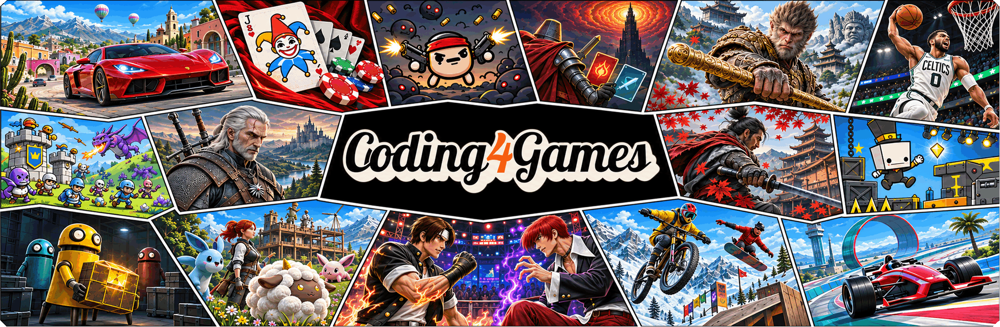
  </picture>
</p>

<h2 align="center">🎮 Coding4Games: Can Modern Coding Agents Play Modern Video Games?</h2>

<h4 align="center">
  <a href="https://zzsf11.github.io/">Shifang Zhao</a><sup>1,2</sup> ·
  <a href="https://zhuomo-1.github.io/">Haoyu Wang</a><sup>3</sup> ·
  <a href="https://yuyangyin.github.io/">Yuyang Yin</a><sup>3</sup> ·
  <a href="https://charliedod.github.io/">Dong Chen</a><sup>4</sup> ·
  <a href="https://flow0314.github.io/">Xingyilang Yin</a><sup>1,2</sup> ·
  <a href="https://yunkangtao.github.io/">Yunkang Tao</a><sup>2</sup><br>
  <a href="https://scholar.google.com.hk/citations?user=j_yFqlsAAAAJ">Honghao Chen</a><sup>1</sup> ·
  <a href="https://wangguangzhi.com/">Guangzhi Wang</a><sup>1</sup> ·
  <a href="https://raymondwang987.github.io/">Yiran Wang</a><sup>1</sup> ·
  <a href="https://pujunfu.github.io/">Junfu Pu</a><sup>1</sup> ·
  <a href="https://scholar.google.com.hk/citations?user=QfKnJ7oAAAAJ">Cheng Cheng</a><sup>1</sup> ·
  <a href="https://vinthony.github.io/academic/">Xiaodong Cun</a><sup>1,2📫</sup> ·
  <a href="https://scholar.google.com.hk/citations?user=4oXBp9UAAAAJ">Ying Shan</a><sup>1</sup>
</h4>

<h6 align="center">
  <sup>1</sup> Tencent Arc Lab ·
  <sup>2</sup> GVC Lab, Great Bay University ·
  <sup>3</sup> Beijing Jiaotong University ·
  <sup>4</sup> Nanjing University
</h6>

<p align="center">
  <strong>A benchmark for coding agents that build programs to play real video games.</strong>
</p>

<p align="center">
  
  <a href="https://coding4game.github.io/"></a>
  <a href="https://coding4game.github.io/arcade/play.html"></a>
</p>

<p align="center">
  <a href="#games"></a>
  <a href="#requirements"></a>
  <a href="#requirements"></a>
  <a href="#requirements"></a>
  <a href="LICENSE"></a>
</p>

<p align="center">
  <a href="#overview">Overview</a> ·
  <a href="#todo">TODO</a> ·
  <a href="#demos">Demos</a> ·
  <a href="#quick-start">Quick start</a> ·
  <a href="#games">Games and saves</a> ·
  <a href="#citation">Citation</a> ·
  <a href="docs/README.md">Docs</a>
</p>

<a name="overview"></a>

## 💡 Overview

<p align="center">
  <picture>
    <source media="(prefers-color-scheme: dark)" srcset="docs/media/evaluation-framework-dark.png">
    <source media="(prefers-color-scheme: light)" srcset="docs/media/evaluation-framework.png">
    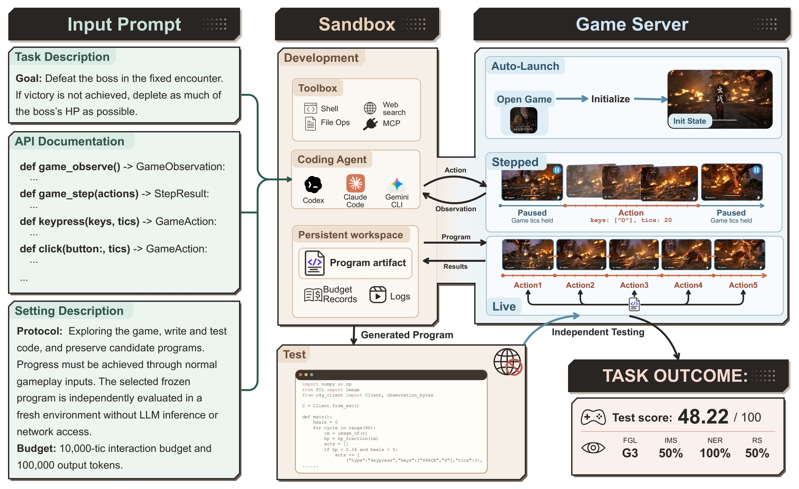
  </picture>
</p>

- During [development](docs/WORKFLOWS.md#develop-a-python-player), a coding agent builds a Python player in WSL 2 using screenshots and stepped game inputs.
- An [independent test](docs/WORKFLOWS.md#independently-test-the-frozen-player) runs the frozen player in a fresh WSL 2 environment without model calls. The Windows host restores the starting state and scores each episode.
- In the [Direct baseline](docs/WORKFLOWS.md#direct-baseline), a model plays the task through the same stepped controls.

<a name="todo"></a>

## 📋 TODO

- [ ] 🎮 Bring more games to Coding4Games and give agents fresh challenges to tackle!
- [ ] 📈 Launch a **continuous benchmark** where the community can submit results and see updates as new runs come in.
- [ ] 🧪 Open up the game environments for **reinforcement learning (RL)** so you can train your own game agents.

<a name="demos"></a>

## 🎬 Demos

These demos show independent final tests of players developed with **Claude Opus 5.5** or **GPT-6 Astra**. Select a game to see its benchmark results and test recordings on the project site.

<table>
  <tr>
    <td align="center" width="33%"><a href="https://coding4game.github.io/results.html?game=black-myth">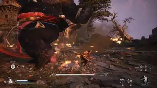</a><br><a href="https://coding4game.github.io/results.html?game=black-myth"><strong>Black Myth: Wukong</strong></a></td>
    <td align="center" width="33%"><a href="https://coding4game.github.io/results.html?game=forza"></a><br><a href="https://coding4game.github.io/results.html?game=forza"><strong>Forza Horizon 5</strong></a></td>
    <td align="center" width="33%"><a href="https://coding4game.github.io/results.html?game=kof98">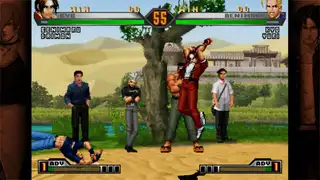</a><br><a href="https://coding4game.github.io/results.html?game=kof98"><strong>The King of Fighters '98 UMFE</strong></a></td>
  </tr>
  <tr>
    <td align="center" width="33%"><a href="https://coding4game.github.io/results.html?game=battleblock">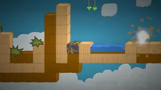</a><br><a href="https://coding4game.github.io/results.html?game=battleblock"><strong>BattleBlock Theater</strong></a></td>
    <td align="center" width="33%"><a href="https://coding4game.github.io/results.html?game=brotato">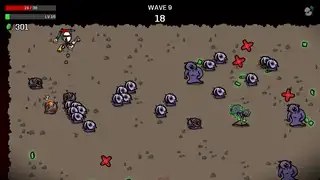</a><br><a href="https://coding4game.github.io/results.html?game=brotato"><strong>Brotato</strong></a></td>
    <td align="center" width="33%"><a href="https://coding4game.github.io/results.html?game=overcooked">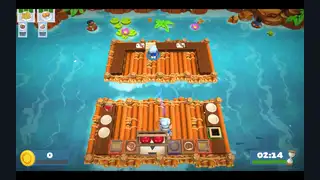</a><br><a href="https://coding4game.github.io/results.html?game=overcooked"><strong>Overcooked! 2</strong></a></td>
  </tr>
  <tr>
    <td align="center" width="33%"><a href="https://coding4game.github.io/results.html?game=aim-lab">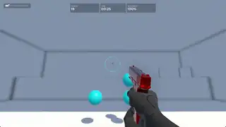</a><br><a href="https://coding4game.github.io/results.html?game=aim-lab"><strong>Aim Lab</strong></a></td>
    <td align="center" width="33%"><a href="https://coding4game.github.io/results.html?game=nba-2k25">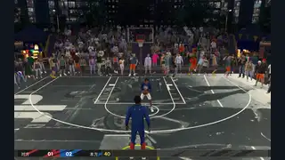</a><br><a href="https://coding4game.github.io/results.html?game=nba-2k25"><strong>NBA 2K25</strong></a></td>
    <td align="center" width="33%"><a href="https://coding4game.github.io/results.html?game=trackmania">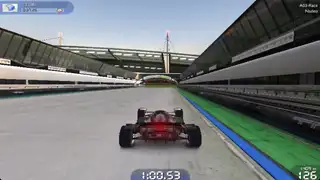</a><br><a href="https://coding4game.github.io/results.html?game=trackmania"><strong>TrackMania Nations Forever</strong></a></td>
  </tr>
  <tr>
    <td align="center" width="33%"><a href="https://coding4game.github.io/results.html?game=balatro">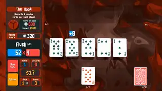</a><br><a href="https://coding4game.github.io/results.html?game=balatro"><strong>Balatro</strong></a></td>
    <td align="center" width="33%"><a href="https://coding4game.github.io/results.html?game=slay-the-spire">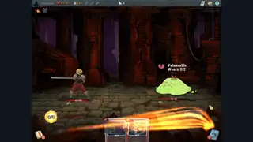</a><br><a href="https://coding4game.github.io/results.html?game=slay-the-spire"><strong>Slay the Spire</strong></a></td>
    <td align="center" width="33%"><a href="https://coding4game.github.io/results.html?game=kingdom-rush">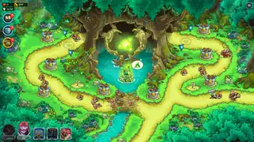</a><br><a href="https://coding4game.github.io/results.html?game=kingdom-rush"><strong>Kingdom Rush 5: Alliance</strong></a></td>
  </tr>
  <tr>
    <td align="center" width="33%"><a href="https://coding4game.github.io/results.html?game=palworld"></a><br><a href="https://coding4game.github.io/results.html?game=palworld"><strong>Palworld</strong></a></td>
    <td align="center" width="33%"><a href="https://coding4game.github.io/results.html?game=sekiro">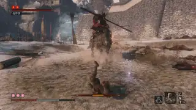</a><br><a href="https://coding4game.github.io/results.html?game=sekiro"><strong>Sekiro: Shadows Die Twice</strong></a></td>
    <td align="center" width="33%"><a href="https://coding4game.github.io/results.html?game=riders-republic">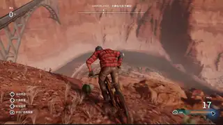</a><br><a href="https://coding4game.github.io/results.html?game=riders-republic"><strong>Riders Republic</strong></a></td>
  </tr>
</table>

<a name="quick-start"></a>

## 🚀 Quick start

> [!TIP]
> The easiest way to get started is to open this repo in **Codex** or **Claude Code** and ask it to help you set up and run your first benchmark.

<a name="requirements"></a>

### 🔧 Requirements

Use **Windows x64** with **Python 3.11 x64** and **WSL 2**. Follow the [Windows setup guide](docs/QUICKSTART.md#1-prepare-the-host) to install ViGEmBus for virtual gamepad input. Each game's guide lists its GPU and other dependencies.

1. **Prepare a game.** Install a supported game on Windows through its launcher, such as Steam, and sign in. Find its setup guide and any required checkpoint ZIP in the [game catalog](docs/SUPPORTED_GAMES.md).
2. **Set up Coding4Games.** Follow the [setup guide](docs/QUICKSTART.md) to download the source and enable WSL 2. Run these commands in PowerShell from the checkout. Confirm each setup and quit the operator menu after the first command.

   ```powershell
   ./scripts/start.ps1 -Setup
   ./scripts/start.ps1 -SetupWsl2
   ```

   For a game that uses OCR, add `-Ocr` to the first command. The second command prepares a Claude Code profile. The [WSL 2 profile guide](docs/QUICKSTART.md#existing-profiles-and-codex) explains how to reuse a profile or set up Codex.

3. **Configure the game and model.** Use the [configuration examples](docs/QUICKSTART.md#2-configure-host-only-settings) to set your game and save paths in `games.local.json`, configure a model in `litellm.config.yaml`, and set its API key on Windows.
4. **Run the benchmark.** Follow the [TUI walkthrough](#tui-walkthrough) to verify startup, develop a player, and score it in an independent test.

<a name="tui-walkthrough"></a>

### 🖥️ TUI walkthrough

From the checkout, run `./scripts/start.ps1` in Windows PowerShell to open the operator menu. Use **↑ / ↓** to move, **Enter** to select, and **Esc** to go back.

<p align="center">
  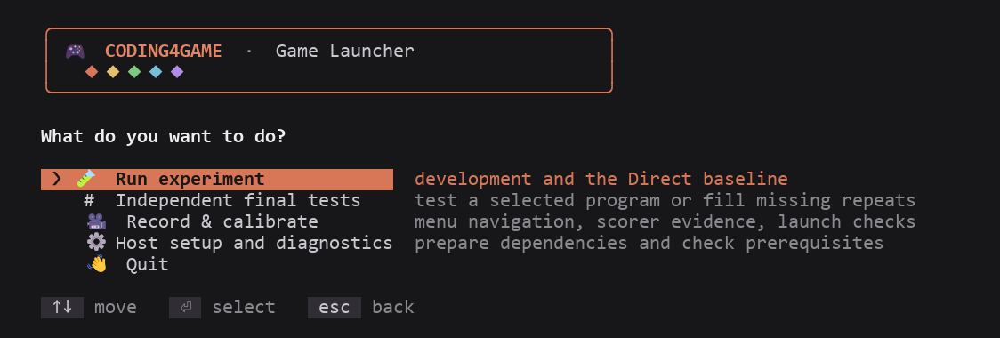
</p>

<details>
<summary>Watch the menu walkthrough (9 seconds)</summary>

<p align="center">
  <picture>
    <source media="(prefers-reduced-motion: reduce)" srcset="docs/media/tui-menu.png">
    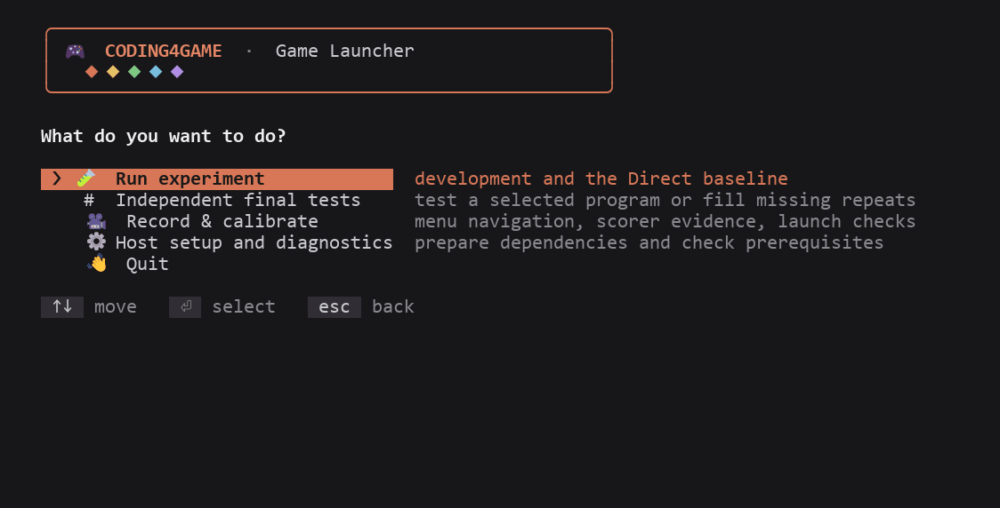
  </picture>
</p>

</details>

1. **Check the host.** Under **Host setup and diagnostics**, choose **Check host prerequisites** to verify the Python dependencies and WSL 2 profile.
2. **Verify the starting state.** Open **Record & calibrate** → **Run auto-launch checks**. Select the driver, then choose **Full auto-launch** for your scenario. If the game menu has changed, use **Record menu navigation** to [update `menu_skip`](docs/WORKFLOWS.md#record-and-verify-menu_skip).
3. **Develop a player.** In **Run experiment**, select a scenario and choose **Claude Code** or **Codex**. Review the model and budgets in **Edit saved settings**, then use **Preview development** before confirming. Select **Direct baseline** to let a model play through the same stepped controls.
4. **Score the frozen player.** In **Independent final tests**, choose **Test a development run**. Enter the run directory and the number of repeats, then review the preview and confirm. Find the [test results](docs/WORKFLOWS.md#independently-test-the-frozen-player) in the run's `test/` folder.

<a name="agent-skills"></a>

### 🤖 Agent skills

Ask Codex or Claude Code to read the relevant skill.

- [`add-new-game`](.agents/skills/add-new-game/SKILL.md) walks through adding or recalibrating a scenario and verifying its starting state, controls, and scoring.
- [`writing-game-auto-launch`](.agents/skills/writing-game-auto-launch/SKILL.md) explains how to configure automatic launch and record `menu_skip`, the inputs that take a game from its title screen to the benchmark task.
- [`analyzing-windows-benchmark-reports`](.agents/skills/analyzing-windows-benchmark-reports/SKILL.md) helps you review scores, resource use, and failures in archived development runs, independent tests, and Direct baselines.

<a name="games"></a>

## 🎮 Games

Install the games separately. The [game catalog](docs/SUPPORTED_GAMES.md) links to setup guides for all 15 scenarios and ZIPs for the ten that need a checkpoint. Keep the archives in [`snapshots/`](snapshots) at the paths listed in the catalog. Follow the [checkpoint guide](snapshots/README.md) to prepare a compatible save when your game account requires one.

<a name="license-and-game-content"></a>

## 📄 License and game content

The [Apache 2.0 license](LICENSE) covers the benchmark code and documentation. Game titles, logos, artwork, screenshots, gameplay footage, and save data are subject to their respective rights holders' terms. Obtain games from their publishers or authorized stores.

<a name="citation"></a>

## 📚 Citation

If you use Coding4Games in your research, please cite the [paper](https://openreview.net/forum?id=BJMuS3H1Oh) using the BibTeX below.

```bibtex
@misc{zhao_coding4games,
  title = {{Coding4Games: Can Modern Coding Agents Play Modern Video Games?}},
  author = {Zhao, Shifang and Wang, Haoyu and Yin, Yuyang and Chen, Dong and
            Yin, Xingyilang and Tao, Yunkang and Chen, Honghao and Wang, Guangzhi and
            Wang, Yiran and Pu, Junfu and Cheng, Cheng and Cun, Xiaodong and Shan, Ying},
  howpublished = {OpenReview},
  url = {https://openreview.net/forum?id=BJMuS3H1Oh}
}
```

<a name="acknowledgements"></a>

## 🙏 Acknowledgements

Thanks to the teams behind [NitroGen](https://github.com/MineDojo/NitroGen) and [GameWorld](https://github.com/gameworld-project/GameWorld) for sharing their research on building and evaluating game-playing agents.

<a name="star-history"></a>

## 📈 Star History

<p align="center">
  <a href="https://www.star-history.com/#GVCLab/Coding4Games&amp;Date">
    <picture>
      <source media="(prefers-color-scheme: dark)" srcset="https://api.star-history.com/svg?repos=GVCLab/Coding4Games&amp;type=Date&amp;theme=dark">
      
    </picture>
  </a>
</p>
